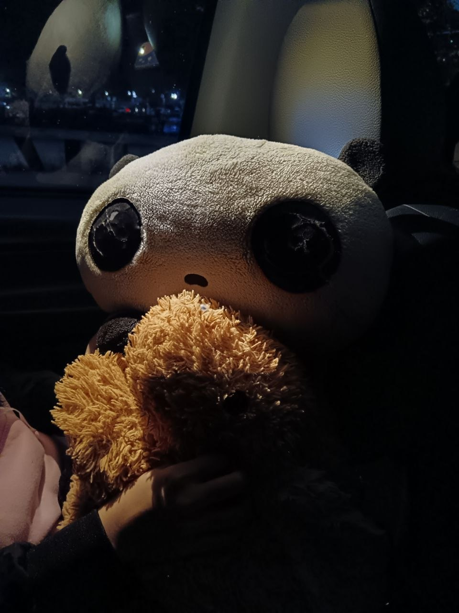

# Introduction

Hi! I'm Jasmine Teo Gie Ming, a student in the Software Maintenance
and Evolution course.

I expect to learn more about software maintenance,
GitHub, and how software can be improved over time.

- **Fun fact**: I enjoy watching movies and listening to music.
- **Course expectations**: To gain hands-on experience in
maintaining and evolving software.

